## The brief
Miles & Meals brings the world's street food home. Every box is built around
signature dishes found on Melanie and Rob's travels and developed with the
locals who cook them — pre-portioned ingredients and step-by-step recipe cards,
no professional skills needed.

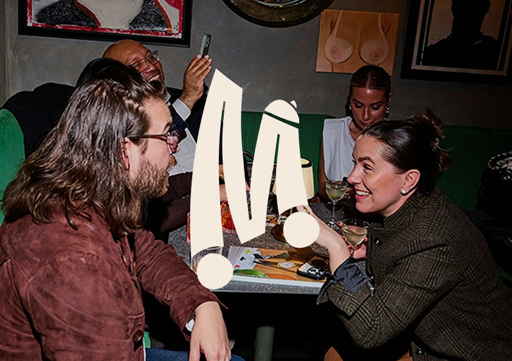

- **Three boxes** — *Local Legend*, the classics people grow up with;
  *Street Made*, fast and bold street dishes; *Neighbourhood Bakes*, snacks,
  breads and treats.
- **Flexible** — four recipes per box, vegetarian or meat, for 2, 4 or 6
  people, weekly or every two weeks. Pause or cancel any time in the app.
- **Lighter on the planet** — compostable packaging, delivery by bike and
  local produce where possible.
- **Launch** — Antwerp first, then the cities of Flanders and the Netherlands.

## Art direction
Instead of the usual meal-kit look, Miles & Meals is designed like an
independent food and travel magazine: bold, editorial and curious, but
approachable. Two sides keep each other in check — **expressive** (bold type,
strong colour, spontaneous photography) and **structured** (clean type, grids,
clear information).

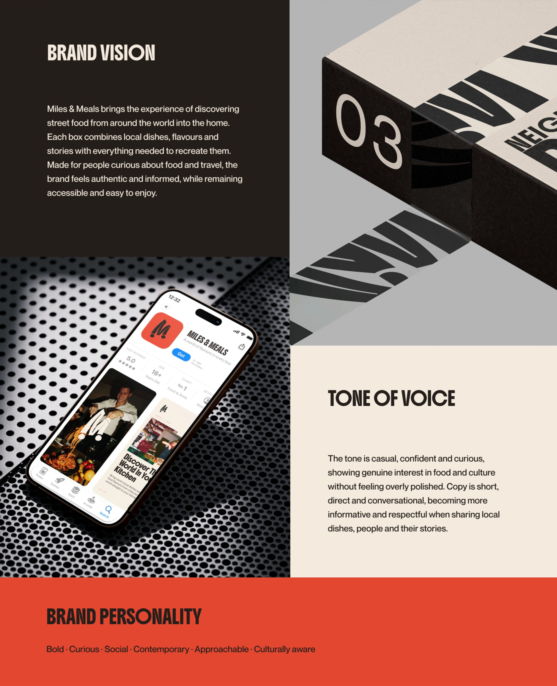

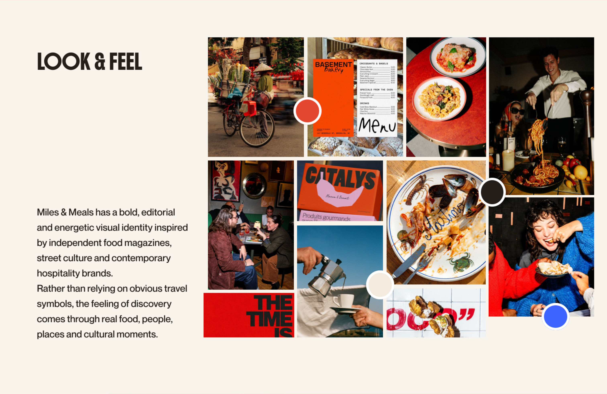

## Logo
The symbol joins a bicycle and a cloche — food and movement, with a nod to
Belgium and to delivery by bike. Sharp forms bring energy; the curves keep it
approachable.

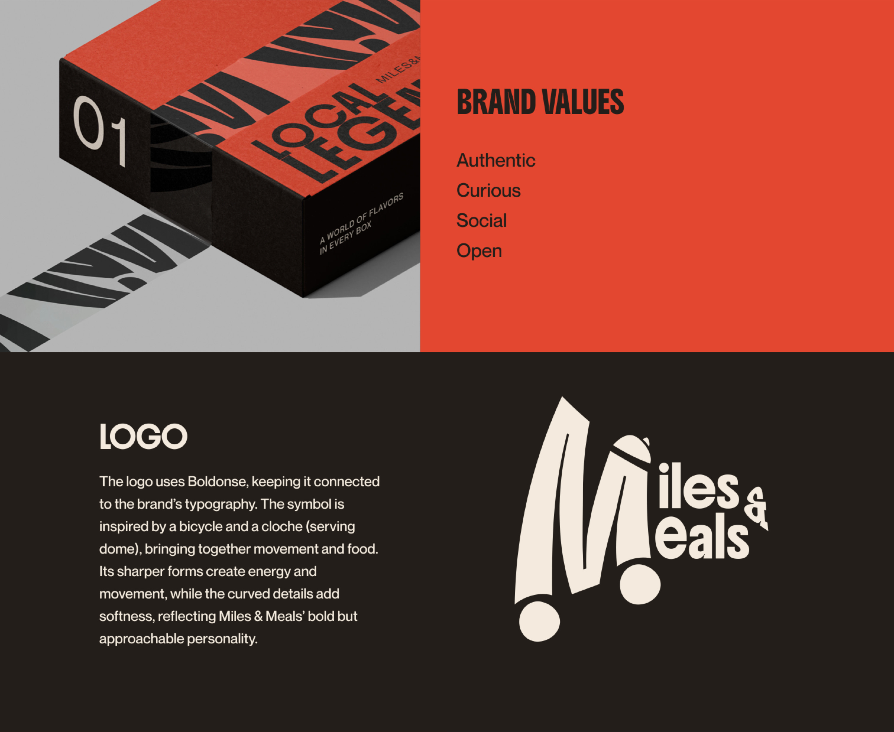

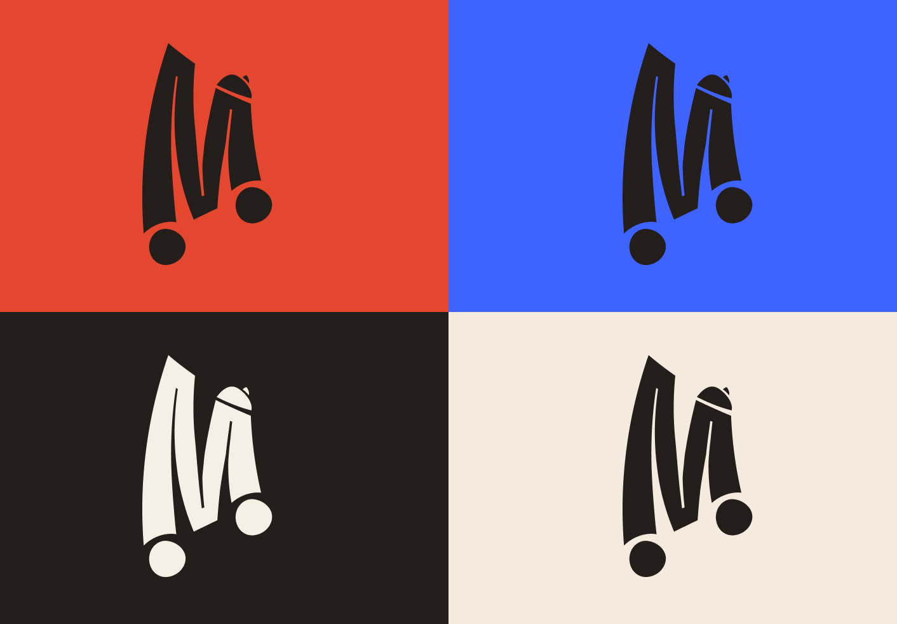

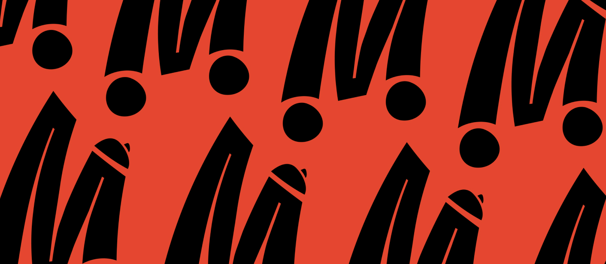

## Colour & type
Warm, food-led colours with one strong contemporary contrast, used selectively
so the photography can lead.

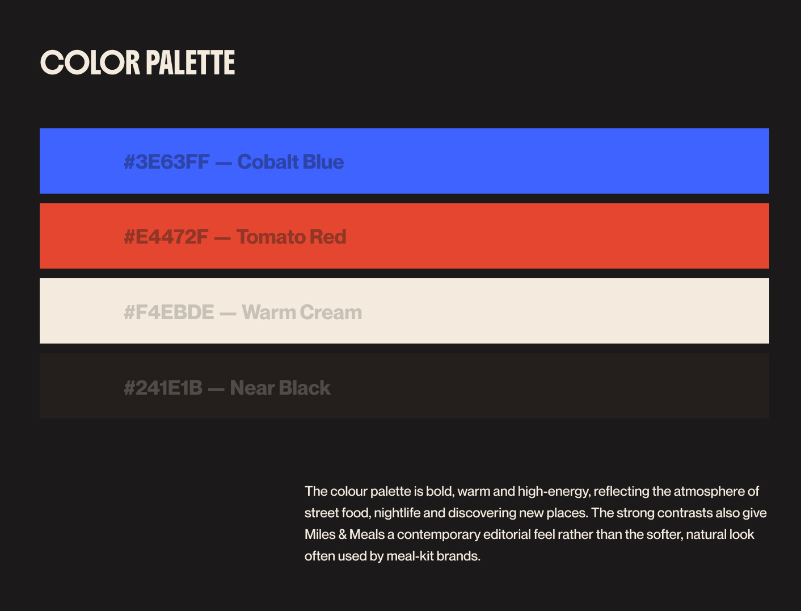

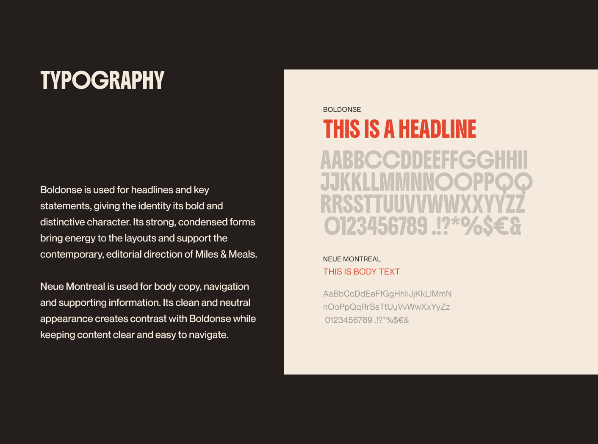

## Iconography
Simple, bold and functional — the structured side of the identity, there to
support navigation and practical information.

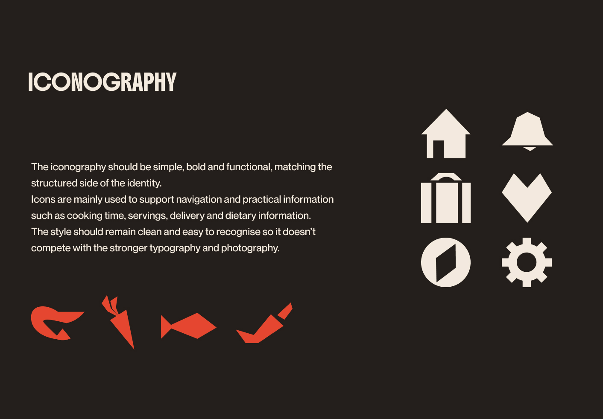

## Photography
Direct flash and documentary in style, borrowing from food, nightlife and
travel photography: people eating together, busy restaurants, markets and city
details — not only perfectly styled dishes.

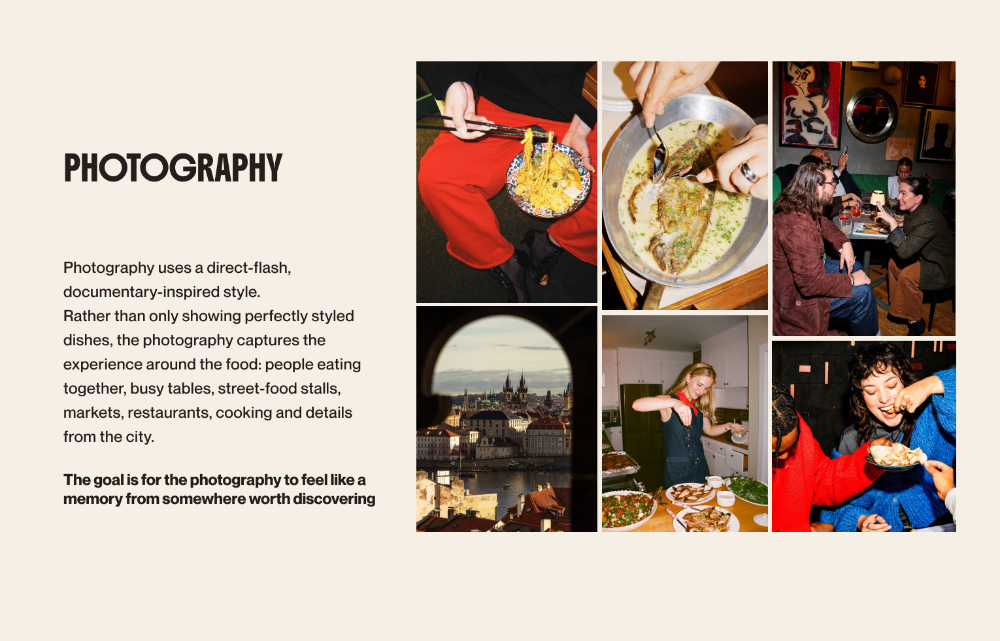

## Applications

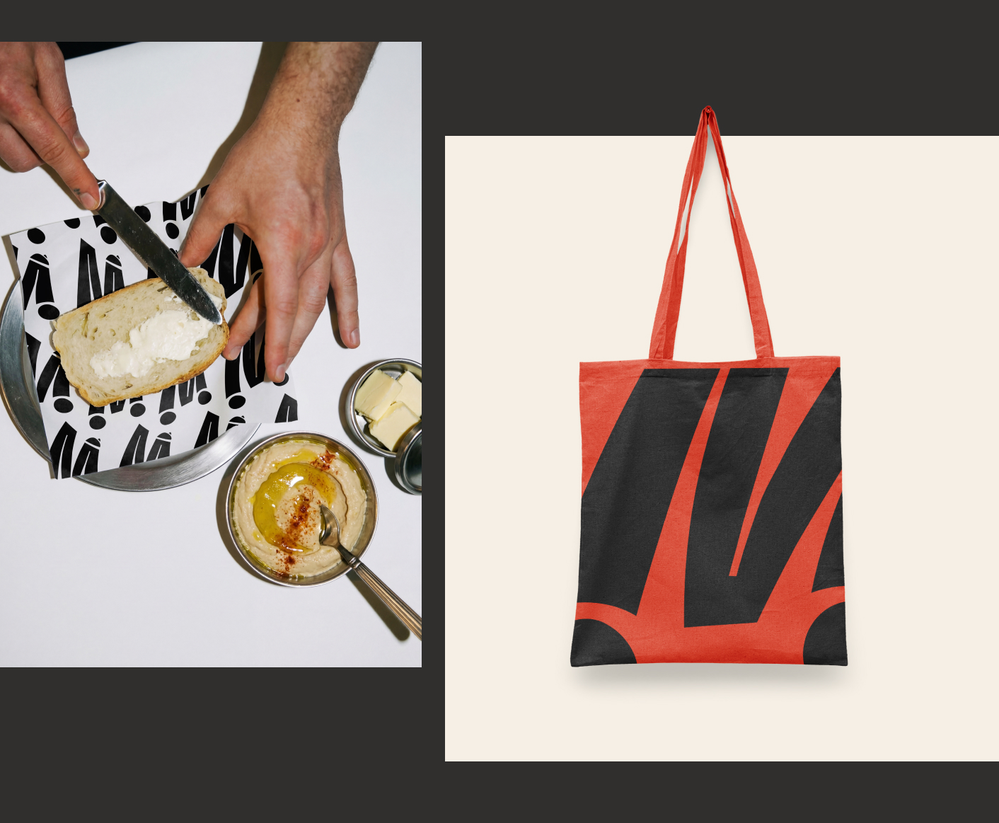

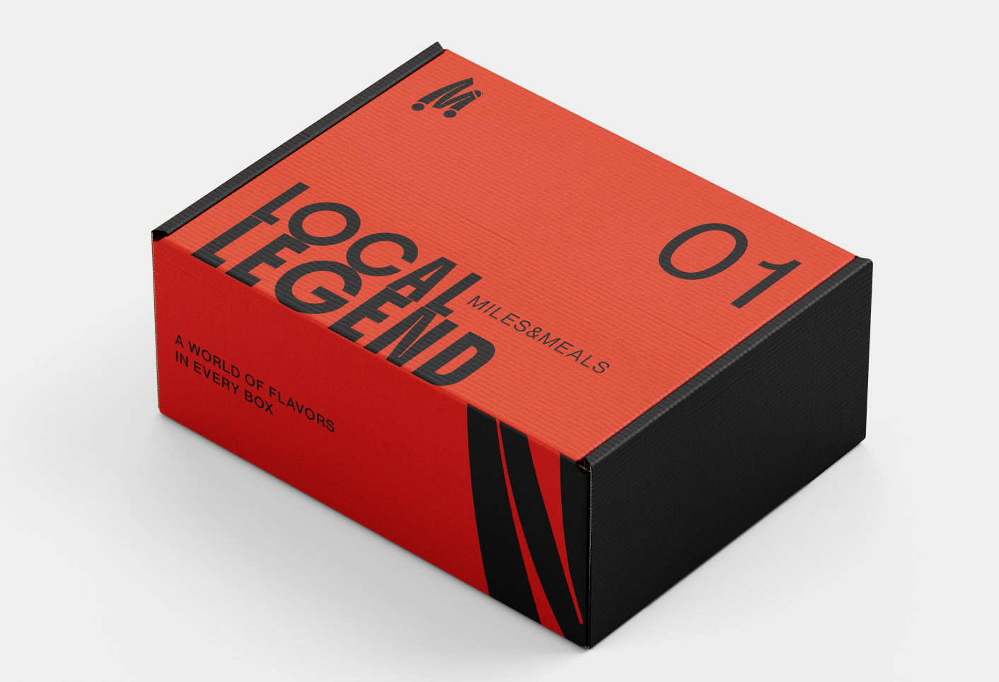

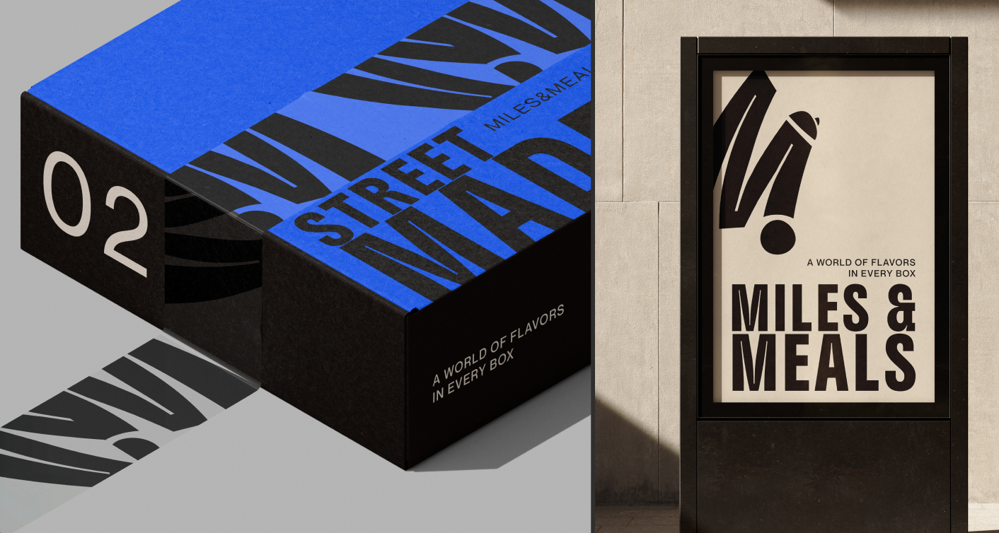

## The app
Plan the next box, follow its delivery, explore cities and cook along step by
step.

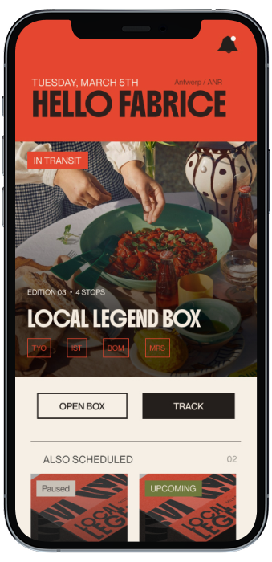

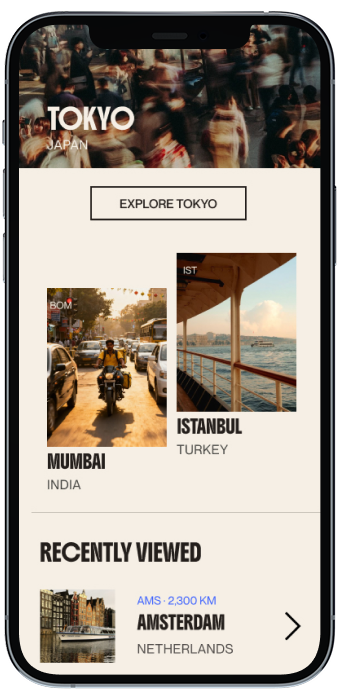

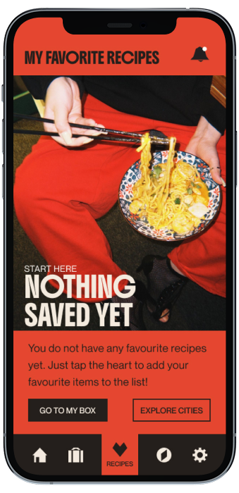

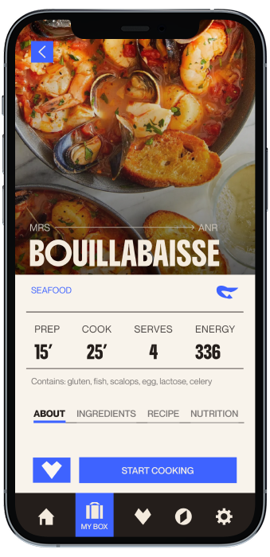

  <iframe
    src="https://player.vimeo.com/video/1232722059?badge=0&autopause=0&dnt=1"
    title="Miles & Meals — app walkthrough"
    loading="lazy"
    allow="autoplay; fullscreen; picture-in-picture"
    referrerpolicy="strict-origin-when-cross-origin"
  ></iframe>

## Why it works
- **Out & Social** — direct flash, people, strong colour.
- **Authentic & Open** — real places and local stories, without stereotypes.
- **Trendy, not mainstream** — editorial references instead of meal-kit
  clichés.
- **Smart** — structured layouts and clear, functional information.
